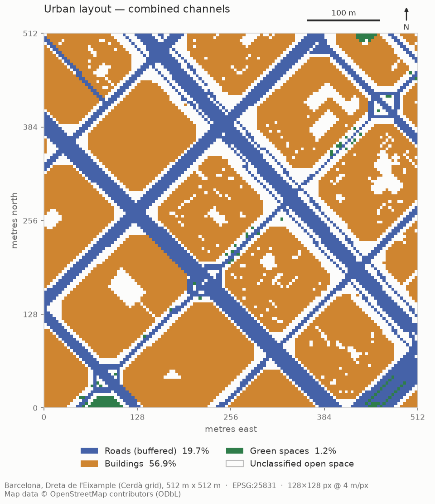

# UrbanMorph

**AI-generated interactive cities — a research project on conditional generative models for urban layouts.**

UrbanMorph aims to learn the structure of real neighbourhoods from OpenStreetMap,
generate new urban layouts with neural networks under explicit planning
constraints (density, street orientation, road width, green coverage,
walkability), turn them into procedural 3D environments (Godot 4), and
evaluate their realism, diversity and controllability.

**Research question.** *Can a conditional generative model produce realistic and
diverse urban layouts while satisfying explicit urban-planning constraints?*

> No novelty is claimed. Prior work on learned city/layout generation exists
> (e.g. InfiniCity, CityDreamer, and GAN/graph-based street-network generators);
> a proper literature review is a planned milestone.

## Status

| Milestone | Status |
|---|---|
| 1. Real OSM data → ML-ready `(3, 128, 128)` layout | ✅ done |
| 2. Multi-sample dataset + literature review | planned |
| 3+. Generative model, 3D conversion, evaluation | planned |



## Data representation (Milestone 1)

One sample = a **512 m × 512 m** square, projected to **EPSG:25831** (ETRS89 / UTM 31N),
rasterized to **128 × 128 px (4 m/px)**, saved as `uint8` with values `{0, 1}`:

| Channel | Meaning | Source (OSM tags) |
|---|---|---|
| 0 | Roads | `highway` ∈ motorway…residential, living_street, pedestrian — centerlines buffered by estimated width, plus road areas |
| 1 | Buildings | any `building=*` except `building=no` |
| 2 | Green spaces | `leisure` park/garden/…, `landuse` grass/forest/…, `natural` wood/scrub/… |

Channels are **independent masks** (a pixel may be in several). Rule: a pixel is 1
iff its **centre** lies in a polygon of that layer. Full details are in
`data/processed/<sample>.json` and [DEVELOPMENT_LOG.md](DEVELOPMENT_LOG.md).

## Installation (macOS, Apple Silicon)

Requires Python 3.11 or 3.12 and Git. All tools are free.

```bash
cd UrbanismProject
python3.12 -m venv .venv
source .venv/bin/activate
pip install --upgrade pip
pip install -e ".[dev]"
```

Dependencies: `osmnx`, `geopandas`, `shapely`, `numpy`, `matplotlib` (+ `pytest` for development).

## Usage

```bash
# 1. Download the Barcelona Eixample neighbourhood (cached in data/raw/; needs internet once)
python scripts/download_osm.py            # add --force to re-download

# 2. Build the raster dataset (offline; reads only the cache)
python scripts/build_raster.py
#  -> data/processed/barcelona_eixample_001.npy          (3,128,128) uint8
#  -> data/processed/barcelona_eixample_001.json         metadata
#  -> data/processed/barcelona_eixample_001_vectors.gpkg projected, clipped vectors

# 3. Visualize
python scripts/visualize.py
#  -> outputs/figures/barcelona_eixample_001_{roads,buildings,green_spaces,combined,vector_vs_raster}.png

# 4. Tests (no internet needed)
python -m pytest -v
```

Loading a sample in Python:

```python
from urbanmorph.data.dataset import load_sample
layout, meta = load_sample("barcelona_eixample_001")   # validates shape, dtype, values, metadata
roads, buildings, green = layout
```

## Repository layout

```
src/urbanmorph/
  config.py                  area, grid, CRS, OSM tags, road-width rules
  data/osm.py                download + cache (Overpass via OSMnx, retries)
  data/dataset.py            save / load / validate samples
  preprocessing/projection.py   CRS projection, sample square, clipping
  preprocessing/roads.py        road-width estimation and buffering
  preprocessing/rasterize.py    pixel-centre rasterizer
  preprocessing/pipeline.py     raw layers -> layout + metadata
  visualization/layout_plot.py  figures
scripts/                     download_osm.py, build_raster.py, visualize.py
tests/                       synthetic + cached-real-data tests
docs/CONCEPTS.md             background: OSM, CRS, rasterization, channels
```

## Data attribution

Map data © [OpenStreetMap contributors](https://www.openstreetmap.org/copyright),
available under the Open Database License (ODbL 1.0). Derived arrays and figures
inherit this attribution requirement.

## Note for iCloud-synced folders

If the project lives in an iCloud-synced folder (e.g. Desktop with "Desktop &
Documents" sync), macOS marks files inside `.venv/` as hidden and Python 3.12
then ignores the editable-install `.pth` file. The scripts and pytest add `src/`
to the import path themselves, so everything still works; in your own notebooks,
either `pip install .` or move the project out of the synced folder.
