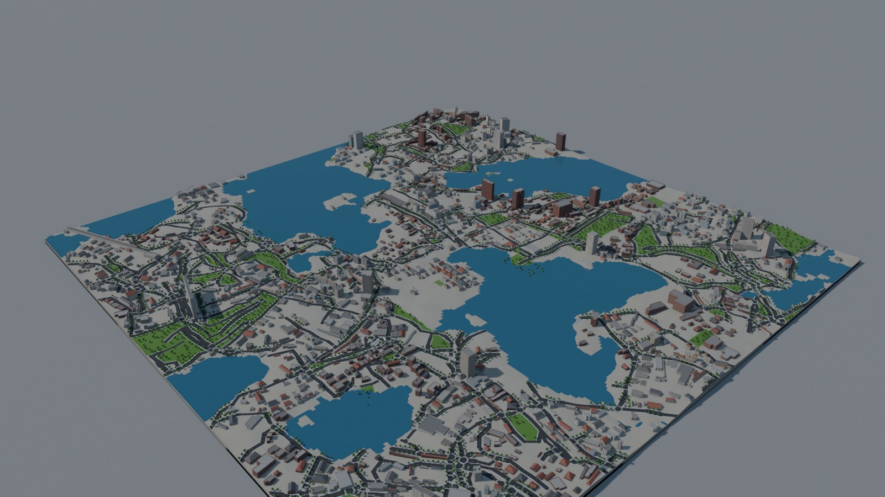
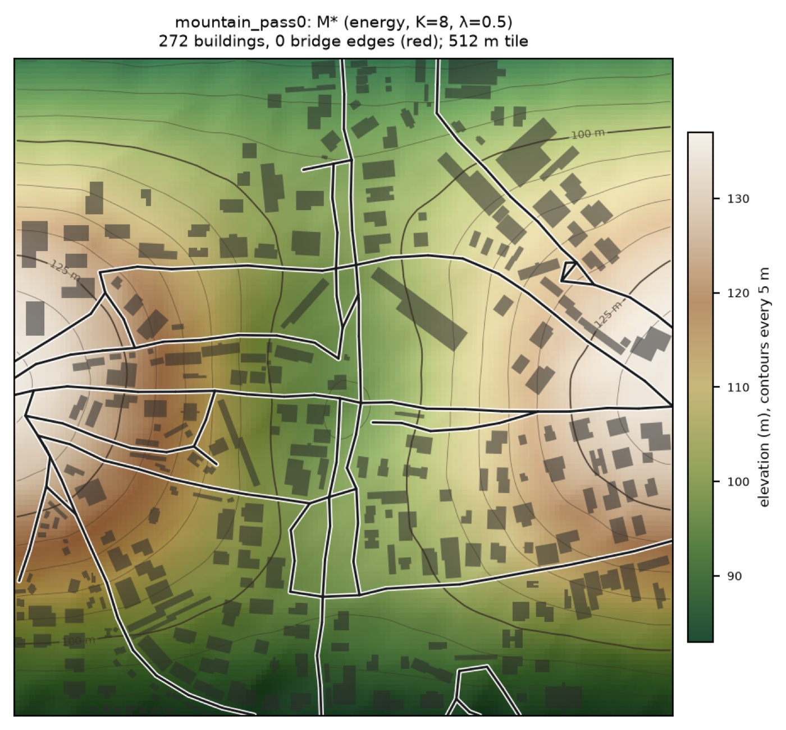
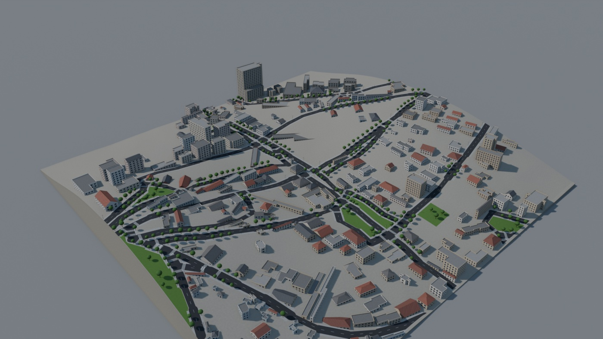

# UrbanMorph

**Learning street networks from real cities and generating terrain-aware, explorable 3D neighbourhoods.**



UrbanMorph learns the structure of real neighbourhoods from OpenStreetMap and elevation data. It generates new
street networks with a neural autoregressive graph model, fills them with procedural blocks, parcels and buildings,
and turns the result into a 3D scene that can be rendered in Blender or walked through in Godot 4. Every model is
evaluated against real cities with protocols that are fixed before the experiments are run.

**Research question.** *Can generative models learn distinct urban morphologies and generate realistic, diverse
neighbourhoods that respond to geography (terrain, rivers, coast) and to planning preferences?*

> **No novelty is claimed.** Closely related published work exists (e.g. Neural Turtle Graphics, GlobalMapper,
> Text2City, CityDreamer, and constrained or look-ahead road generation). See the literature reviews in
> [`docs/`](docs/).

## Pipeline

```
OpenStreetMap extracts ─┐
                        ├─► 512 m tiles: street graphs, buildings, parcels, green, water, elevation (4 m grid)
Elevation models (DEM) ─┘                                    │
                                                             ▼
          terrain-aware street-graph generator (CNN encoder + GRU decoder, mixture-density steps)
                     + constrained sampling (hard feasibility rules, learned potentials, look-ahead, SMC)
                                                             │
                                                             ▼
          procedural blocks → parcels → buildings (heights, roofs, façades) → sidewalks, trees, bridges
                                                             │
                                                             ▼
                 watertight meshes → Blender renders + GLB export → Godot 4 walk / fly viewer
```

| Generated streets on the terrain (mountain pass) | The same city in 3D |
|---|---|
|  |  |

## Data

* **~600 tiles of 512 m × 512 m** from 9 cities in Spain (Barcelona, Madrid, Valencia), the United States (New York,
  Chicago, Los Angeles) and Japan (Tokyo, Osaka, Nagoya), drawn by stratified sampling on satellite-derived built-up
  density (GHSL), not on OSM itself.
* **Spatial splits.** 3 km blocks are assigned whole to train / validation / test, with a 1 km buffer between splits.
  Test tile IDs are fingerprinted (SHA-256) in the test suite, so a changed split fails the tests.
* **Elevation.** Spain: IGN MDT05 (5 m, LiDAR). US: USGS 3DEP (1 m, LiDAR). Resampled to the 4 m tile grid with
  native-pixel alignment. Japan has no elevation yet: the GSI licence terms for research use are unresolved.
* **Unseen-city generalisation set.** 100 tiles from San Francisco, Girona and Manresa, never used for training or
  selection. San Diego tiles serve the same purpose in Milestone 12.
* **Reproducible.** All OSM data comes from dated Geofabrik extracts (one replication timestamp) clipped locally with
  `osmium`; nothing depends on live API state.

## Results by milestone

Each milestone has a design document, a pre-registered evaluation protocol where applicable, and a results document
in [`docs/`](docs/). Negative results are reported as such.

| # | Milestone | Outcome |
|---|---|---|
| 1 | OSM → ML-ready `(3, 128, 128)` raster (Barcelona) | Done |
| 2 | Multi-city dataset: Spain, US, Japan (135 tiles, 9 cities) | Done; quality flags and caveats in [quality reports](outputs/m2/quality/) |
| 3 / 3b | Convolutional VAE baseline; +468 training tiles, spatial latent, road-aware loss | Road IoU on reconstruction 0.05 → 0.82; *generated* layouts not realistic ([M3](docs/MILESTONE_3.md), [M3b](docs/MILESTONE_3B.md)) |
| — | Topology-aware loss (soft-clDice) | No robust connectivity gain; the bottleneck is the prior ([report](docs/ROAD_TOPOLOGY_EXPERIMENT.md)) |
| 4 | Learned autoregressive latent prior (Gated PixelCNN) | Fragmentation roughly halved, diversity kept; target not met ([M4](docs/MILESTONE_4.md)) |
| 5 | Street-graph generator inspired by Neural Turtle Graphics | Connected by construction, no memorisation; street structure not yet realistic ([M5](docs/MILESTONE_5.md)) |
| 6 | Hybrid neural-procedural generation (roads → buildings → green) | Valid buildings and green exported for 3D; country differences lost ([M6](docs/MILESTONE_6.md)) |
| 7 | Hard constraints and street-frontage building patterns | No overlaps or buildings on roads; rows and setbacks closer to real ([M7](docs/MILESTONE_7.md)) |
| 8 | Parcel-aware generation | Parcels fix building alignment; pre-registered criteria not met ([M8](docs/MILESTONE_8.md)) |
| 9 | Tidy subdivision, green zoning, template building shapes | 0 clipped buildings (vs 8,083); too many empty lots; criteria not met ([M9](docs/MILESTONE_9.md)) |
| 10 | Hierarchical street and block generation | Context-noise training halves the street-realism score (1.23 → 0.50); junction-angle criterion still failed ([M10](docs/MILESTONE_10.md)) |
| 11 | Procedural 3D cities: Blender rendering, Godot viewer | 2,823 buildings, all watertight; GLB scenes walkable in Godot ([M11](docs/MILESTONE_11.md)) |
| 12 | Terrain-aware street-graph generator | Terrain fit improves strongly over a terrain-blind model, but part of the gain is street traces in the DEM; a low-pass control keeps about three quarters of it ([M12](docs/MILESTONE_12.md), [results](docs/M12_RESULTS.md)) |
| 13 | Terrain-constrained sampling and look-ahead (SMC, beam, energy-guided) | **Negative result:** gains vanish under leakage controls and density matching. Hard constraints remove all unbridged water crossings and 90 % of spurious bridges ([M13](docs/MILESTONE_13.md), [report](outputs/m13/FINAL_REPORT.md)) |

All Milestone 12–13 numbers come from development data. The held-out test splits have not been evaluated yet.

## Installation (macOS, Apple Silicon)

Requires Python 3.11 or 3.12, Git and Homebrew. All tools are free.

```bash
python3.12 -m venv .venv
source .venv/bin/activate
pip install --upgrade pip
pip install -e ".[dev,ml]"      # ml = PyTorch (MPS on Apple Silicon, CPU fallback)
brew install osmium-tool        # clips tiles from OSM extracts
```

Optional, for 3D: [Blender](https://www.blender.org/) (5.x, expected at `/Applications/Blender.app` or in the
`BLENDER` environment variable) and [Godot 4](https://godotengine.org/) for the interactive viewer.

## Quick start

```bash
python -m pytest -q                                   # 238 tests, no internet needed; data tests skip if data is absent

# Build the six demo cities (flat, hills, steep, river, mountain pass, coast) with the selected sampler and the
# standard baseline: street generation -> buildings -> Blender renders -> GLB (needs trained models and Blender)
bash scripts/m13_demo_cities.sh                       # -> outputs/m12/cities/m12_<terrain>_TN_s0_tc-{energy,standard}_s2041/

# Walk through it in Godot (absolute paths: --path changes the working directory)
GODOT=/Applications/Godot.app/Contents/MacOS/Godot
C="$PWD/outputs/m12/cities/m12_mountain_pass0_TN_s0_tc-energy_s2041"
$GODOT --path godot/viewer -- --glb "$C/scene.glb" --viewer "$C/viewer.json"

# Aerial elevation maps (hypsometric tint, hillshade, contours) of the demo cities
python scripts/m13_elevation_maps.py
```

Reproducing Milestone 13 end to end (training, selection, confirmatory tiers, ablations, report) uses an unattended,
resumable runner:

```bash
python scripts/m13_run_all.py start --config configs/m13_full.toml --caffeinate
python scripts/m13_run_all.py status
python scripts/m13_report.py                           # -> outputs/m13/FINAL_REPORT.md and figures
```

Data preparation and the commands of earlier milestones are listed in each `docs/MILESTONE_*.md` and in the
collapsed section below.

## Repository layout

```
src/urbanmorph/
  data/, sampling/, splits/, quality/   OSM and GHSL processing, stratified sampling, spatial splits, quality flags
  preprocessing/, metrics/              rasterisation, morphology metrics
  graphs/                               street-graph sequences, generation loop, terrain metrics,
                                        constrained sampler (tc_sampler.py), potentials, repair
  terrain/                              heightfields, hydrology, road feasibility (grades, water, structures)
  models/                               VAE, PixelCNN prior, GraphTurtle / TerrainGraphTurtle, checkpointing
  layout/                               blocks, parcels, building placement
  city3d/                               city format, meshes, façades, terrain mesh, validation, scene assembly
  visualization/                        figures
scripts/                                one entry point per step, prefixed by milestone (m2_…, m12_…, m13_…)
configs/                                every experiment parameter (TOML / JSON); hashes stored with outputs
blender/, godot/viewer/                 Blender scene script and the Godot 4 viewer project
docs/                                   design documents, protocols, results, literature reviews, manuscript draft
tests/                                  unit tests with exact synthetic values + split-integrity checks
```

<details>
<summary><b>Data representation and Milestone 1–3b commands</b></summary>

### Raster representation (Milestones 1–4)

One sample is a **512 m × 512 m** tile in the city's UTM zone, rasterised to **128 × 128 px (4 m/px)** as `uint8`:

| Channel | Meaning | Source (OSM tags) |
|---|---|---|
| 0 | Roads | `highway` ∈ motorway…residential (+ `_link`), living_street, pedestrian: centerlines buffered by estimated width, plus road areas |
| 1 | Buildings | any `building=*` except `building=no` |
| 2 | Green spaces | `leisure` park/garden/…, `landuse` grass/forest/…, `natural` wood/scrub/… |

The channels are independent masks; a pixel is 1 when its centre lies inside a polygon of that layer. From Milestone 5
on, streets are vector graphs and buildings are polygons.

**Caveats.** 77 % of Japanese road segments use class-default widths (7–8 m) where many real streets are about 4 m,
so raster road coverage is inflated in Japan. 18 of the 135 pilot tiles are flagged for incomplete building mapping
(mostly container ports). The study is restricted to well-mapped cities (median OSM/GHSL building coverage ≥ 0.5),
which are mostly in high-income countries.

### Milestone 1 (single Barcelona tile)

```bash
python scripts/download_osm.py            # Overpass download, cached in data/raw/
python scripts/build_raster.py            # -> data/processed/barcelona_eixample_001.{npy,json}
python scripts/visualize.py               # -> outputs/figures/
```

### Milestone 2 (multi-city dataset)

```bash
# A. Sampling plan: city boundaries (9 Nominatim requests) + GHSL tiles (~135 MB, JRC), no OSM
python scripts/m2_plan_sampling.py --calibrate   # first time: freezes density thresholds in configs/m2_pilot.toml
python scripts/m2_plan_sampling.py               # later runs: deterministic

# B. OSM data: download 9 dated Geofabrik extracts once (~3.4 GB), then clip tiles locally
mkdir -p data/raw/osm_extracts && cd data/raw/osm_extracts
for r in europe/spain/cataluna europe/spain/madrid europe/spain/valencia \
         north-america/us/new-york north-america/us/illinois north-america/us/california/socal \
         asia/japan/kanto asia/japan/kansai asia/japan/chubu; do
  f=$(echo $r | tr / _)-latest.osm.pbf
  curl -L -o "$f" "https://download.geofabrik.de/$r-latest.osm.pbf"
  curl -L -o "$f.md5" "https://download.geofabrik.de/$r-latest.osm.pbf.md5"
done
cd ../../..
python scripts/m2_download.py                    # ~2 s per tile, no network

# C. Process, quality-check, split (offline)
python scripts/m2_build_dataset.py

# D. Exploratory comparison and interactive explorer
python scripts/m2_analysis.py
python scripts/m2_explorer.py
```

`latest` extracts change daily; check `snapshot.osm_replication_timestamp` in each tile's `download_info.json`. To
reproduce this dataset exactly, keep the extracts or the per-tile cache in `data/raw/osm/`.

```python
from urbanmorph.data.m2_dataset import load_index, load_m2_sample
index = load_index()
train = index[(index.in_dataset) & (index.split == "train")]
layout, meta = load_m2_sample(train.sample_id.iloc[0], index)   # validated (3,128,128) uint8 + metadata
```

### Milestones 3 and 3b (VAE baseline, controlled experiments)

```bash
python scripts/m3_train.py --smoke               # 2-epoch smoke test
python scripts/m3_sweep.py                       # VAE z{16,32} x beta{0.1,0.5,1} + AE baselines
python scripts/m3_evaluate.py --vae vae_z32_b0.5 --ae ae_z32
python scripts/m3b_expansion_plan.py --write --per-city 60 --spacing 1024   # +468 train-only tiles
python scripts/m3b_experiments.py
```

</details>

## Data attribution

* Map data © [OpenStreetMap contributors](https://www.openstreetmap.org/copyright), ODbL 1.0, via
  [Geofabrik](https://download.geofabrik.de/) extracts and the Overpass API.
* Built-up surface: GHS-BUILT-S R2023A, European Commission JRC (Pesaresi & Politis 2023), CC BY 4.0.
* Elevation, Spain: MDT05 © Instituto Geográfico Nacional (IGN), CC BY 4.0 (scne.es).
* Elevation, United States: USGS 3D Elevation Program (3DEP), public domain; courtesy of the U.S. Geological Survey.

Raw elevation and OSM files are not redistributed (git-ignored). Derived arrays and figures inherit the attribution
requirements above.

## Note for iCloud-synced folders

If the project lives in an iCloud-synced folder, macOS marks files inside `.venv/` as hidden, and Python 3.12 then
ignores the editable-install `.pth` file. The scripts and pytest add `src/` to the import path themselves; in
notebooks, either `pip install .` or move the project out of the synced folder.
