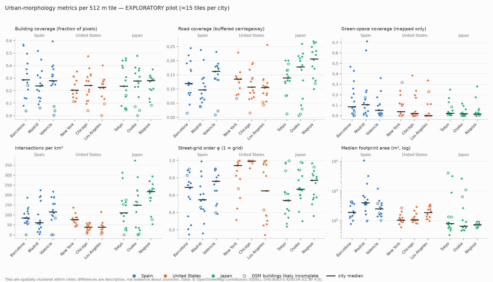

# UrbanMorph

**AI-generated interactive cities — a research project on conditional generative models for urban layouts.**

UrbanMorph aims to learn the structure of real neighbourhoods from OpenStreetMap,
generate new urban layouts with neural networks under explicit planning
constraints (density, street orientation, road width, green coverage,
walkability), turn them into procedural 3D environments (Godot 4), and
evaluate their realism, diversity and controllability.

**Research question.** *Can generative models learn distinct urban morphologies and generate
realistic, diverse neighbourhoods conditioned on geographic context and urban-planning preferences?*

> No novelty is claimed. Closely related published work exists (e.g. Text2City, GlobalMapper,
> GANmapper, Neural Turtle Graphics, CityDreamer); see [docs/LITERATURE_REVIEW.md](docs/LITERATURE_REVIEW.md).

## Status

| Milestone | Status |
|---|---|
| 1. Real OSM data → ML-ready `(3, 128, 128)` layout (Barcelona) | ✅ done |
| 2. Comparative pilot dataset: Spain, United States, Japan (135 tiles, 9 cities) | ✅ pilot done (v2) |
| 3. First generative model: convolutional VAE baseline | ✅ baseline done (does **not** yet produce realistic layouts; see [docs/MILESTONE_3.md](docs/MILESTONE_3.md)) |
| 3b. Controlled experiments: +468 train tiles, spatial latent, road-aware loss | ✅ done: reconstruction road IoU 0.05 → 0.82; generation still not realistic ([docs/MILESTONE_3B.md](docs/MILESTONE_3B.md)) |
| Road topology: soft-clDice on roads (C2) | ✅ done: no robust connectivity gain; the problem is the prior ([docs/ROAD_TOPOLOGY_EXPERIMENT.md](docs/ROAD_TOPOLOGY_EXPERIMENT.md)) |
| 4+. Learned autoregressive spatial prior, 3D conversion | planned |



## Data representation

One sample is a **512 m × 512 m** tile in the city's UTM zone (WGS84 / UTM, `EPSG:326xx/327xx`;
Milestone 1 used ETRS89 / UTM 31N, which differs by less than 1 m), rasterised to **128 × 128 px
(4 m/px)** as `uint8` with values `{0, 1}`:

| Channel | Meaning | Source (OSM tags) |
|---|---|---|
| 0 | Roads | `highway` ∈ motorway…residential (+ `_link`), living_street, pedestrian: centerlines buffered by estimated width, plus road areas |
| 1 | Buildings | any `building=*` except `building=no` |
| 2 | Green spaces | `leisure` park/garden/…, `landuse` grass/forest/…, `natural` wood/scrub/… |

The channels are **independent masks**: a pixel may belong to more than one. A pixel is 1 when
its **centre** lies inside a polygon of that layer.

## Milestone 2 pilot dataset (exploratory)

* **9 cities × 15 tiles = 135 tiles**: Barcelona, Madrid, Valencia · New York, Chicago, Los Angeles · Tokyo (23 wards), Osaka, Nagoya.
* **Why these countries:** the first version (Spain, Peru, South Korea; archived in
  `data/processed/m2_v1_peru_korea/`, `outputs/m2_v1_peru_korea/`) showed that OSM building mapping
  in Peru and Korea was too incomplete to compare. Study cities must now have a median OSM/GHSL
  building-coverage ratio ≥ 0.5 (all nine pass: 0.63–0.94). **This deliberately restricts the
  study to well-mapped cities, which are mostly in high-income countries.** Results do not
  generalise to the places that were excluded.
* **Sampling:** a stratified random draw from a fixed 512 m grid inside each city's main built-up
  agglomeration. Strata come from satellite-derived GHSL data (density × era of urbanisation),
  not from OSM, and selected tiles are at least 1.5 km apart. See [DEVELOPMENT_LOG.md](DEVELOPMENT_LOG.md).
* **OSM source:** Geofabrik regional extracts, all from the **same replication state, 2026-10-28T21:21:02Z**,
  clipped locally with `osmium`. This puts no load on public APIs and makes the dataset reproducible.
* **Splits:** 3 km spatial blocks are assigned whole to train/val/test, with a 1 km buffer
  between splits. Leave-one-city-out evaluation is supported.
* **⚠ Caveats:** (1) Road widths: 77% of Japanese road segments use class-default widths (7–8 m)
  where many real streets are about 4 m, so **road coverage is inflated in Japan** and not yet
  comparable across countries. (2) 18/135 tiles are still flagged as having incomplete building
  mapping. Most are container ports (a GHSL false positive), plus two genuine gaps in eastern Tokyo.
  See the [quality reports](outputs/m2/quality/).

## Installation (macOS, Apple Silicon)

Requires Python 3.11 or 3.12, Git and Homebrew. All tools are free.

```bash
cd UrbanismProject
python3.12 -m venv .venv
source .venv/bin/activate
pip install --upgrade pip
pip install -e ".[dev]"
brew install osmium-tool        # Milestone 2: clips tiles from OSM extracts
```

Python dependencies: `osmnx`, `geopandas`, `shapely`, `numpy`, `matplotlib`, `rasterio` (+ `pytest`; `torch` via the `ml` extra for Milestone 3).

## Milestone 1 usage (single Barcelona tile)

```bash
python scripts/download_osm.py            # Overpass download, cached in data/raw/
python scripts/build_raster.py            # -> data/processed/barcelona_eixample_001.{npy,json}
python scripts/visualize.py               # -> outputs/figures/
```

## Milestone 2 usage (multi-city dataset)

```bash
# A. Sampling plan: city boundaries (9 Nominatim requests) + GHSL tiles (~135 MB, JRC), no OSM
python scripts/m2_plan_sampling.py --calibrate   # first time: freezes density thresholds in configs/m2_pilot.toml
python scripts/m2_plan_sampling.py               # later runs: deterministic
#    -> data/processed/m2/sampling/plan.csv, outputs/m2/sampling/<CITY>.png

# B. OSM data: download 9 dated Geofabrik extracts once (~3.4 GB), then clip tiles locally
mkdir -p data/raw/osm_extracts && cd data/raw/osm_extracts
for r in europe/spain/cataluna europe/spain/madrid europe/spain/valencia \
         north-america/us/new-york north-america/us/illinois north-america/us/california/socal \
         asia/japan/kanto asia/japan/kansai asia/japan/chubu; do
  f=$(echo $r | tr / _)-latest.osm.pbf
  curl -L -o "$f" "https://download.geofabrik.de/$r-latest.osm.pbf"
  curl -L -o "$f.md5" "https://download.geofabrik.de/$r-latest.osm.pbf.md5"
done
cd ../../..
python scripts/m2_download.py --dry-run          # shows the workload
python scripts/m2_download.py                    # ~2 s per tile, no network

# C. Process, quality-check, split (offline)
python scripts/m2_build_dataset.py
#    -> data/processed/m2/<country>/<city>/<id>.{npy,json,_vectors.gpkg}
#    -> data/processed/m2/samples.csv, city_completeness.csv, outputs/m2/quality/<CITY>.md

# D. Exploratory comparison
python scripts/m2_analysis.py                    # -> outputs/m2/analysis/

# E. Inspect the dataset interactively (Matplotlib window)
python scripts/m2_explorer.py
python scripts/m2_explorer.py --a USA_NYC_e1143_n8779 --b JPN_TYO_e751_n7688 --save cmp.png
```

> `latest` extracts change daily. Re-downloading gives a newer snapshot; check
> `snapshot.osm_replication_timestamp` in each tile's `download_info.json`. To reproduce *this*
> dataset exactly, keep the extracts (or the per-tile cache in `data/raw/osm/`).

Loading samples in Python:

```python
from urbanmorph.data.m2_dataset import load_index, load_m2_sample
index = load_index()                                   # one row per tile: metrics, flags, split, provenance
train = index[(index.in_dataset) & (index.split == "train")]
layout, meta = load_m2_sample(train.sample_id.iloc[0], index)   # validated (3,128,128) uint8 + metadata
```

## Milestone 3 usage (VAE baseline)

```bash
pip install -e ".[dev,ml]"                       # adds PyTorch (MPS on Apple Silicon, CPU fallback)
python scripts/m3_dataset_audit.py               # independent dataset audit -> outputs/m3/dataset_audit.md
python scripts/m3_train.py --smoke               # 2-epoch smoke test
python scripts/m3_sweep.py                       # VAE z{16,32} x beta{0.1,0.5,1} + AE baselines (~8 min)
python scripts/m3_evaluate.py --vae vae_z32_b0.5 --ae ae_z32   # validation metrics + figures -> outputs/m3/
```

Result in one line: the VAE beats a trivial baseline on building and green layout, but it does
**not** reconstruct or generate street networks (road IoU ≤ 0.08). The main limit is 97 training
tiles squeezed through a 32-number latent.

## Milestone 3b usage (controlled experiments)

```bash
python scripts/m3b_expansion_plan.py --write --per-city 60 --spacing 1024   # +468 train-only tiles
python scripts/m2_download.py --plan data/processed/m2/sampling/expansion_m3b.csv
python scripts/m3b_build_expansion.py           # asserts val/test separation, writes samples_expansion_m3b.csv
python scripts/m3b_experiments.py               # A, B, C1, C2 + identical evaluation -> outputs/m3b/
```

## Tests

```bash
python -m pytest -v        # 93 tests, no internet needed; real-data tests skip if the data is absent
```

## Repository layout

```
configs/m2_pilot.toml           every M2 parameter (cities, backups, thresholds, seeds); its hash is stored per sample
configs/m2_pilot_v1_peru_korea.toml   archived v1 config (not used)
src/urbanmorph/
  config.py                     area spec, CRS, OSM tags, road-width rules, paths
  data/osm.py                   Overpass download + raw cache format (shared)
  data/osm_extract.py           same cache built from Geofabrik extracts with osmium
  data/dataset.py               M1 save / load / validate
  data/m2_dataset.py            M2 processing, metadata, provenance, index table
  preprocessing/                projection, road buffering, rasterizer, pipeline (M1, reused)
  sampling/                     study area, GHSL, candidate grid, strata, selection
  metrics/morphology.py         coverage, buildings, intersections, orientation
  quality/checks.py             per-sample and dataset-level quality flags
  splits/geographic.py          block splits, buffer, city hold-out
  visualization/                M1 plots, M2 comparison figures
  models/                       M3: VAE/AE, losses, data loader, training, evaluation, plots
scripts/                        M1: download_osm, build_raster, visualize · M2: m2_* (A–E above)
tests/                          synthetic exact-value tests + cached-real-data tests
docs/CONCEPTS.md                background concepts (M1 + M2)
docs/LITERATURE_REVIEW.md       verified related work + our open questions
docs/MILESTONE_3.md             VAE baseline: architecture, objective, results, limitations
docs/MILESTONE_3B.md            controlled experiments: data, spatial latent, loss, sampling diagnosis
docs/ROAD_TOPOLOGY_EXPERIMENT.md soft-clDice, topology metrics, structural-bias tests, prior diagnosis
```

## Data attribution

* Map data © [OpenStreetMap contributors](https://www.openstreetmap.org/copyright), ODbL 1.0
  (via [Geofabrik](https://download.geofabrik.de/) extracts and the Overpass API).
* Built-up surface: GHS-BUILT-S R2023A, European Commission JRC (Pesaresi & Politis 2023), CC BY 4.0.

Derived arrays and figures inherit these attribution requirements.

## Note for iCloud-synced folders

If the project lives in an iCloud-synced folder, macOS marks files inside `.venv/` as hidden,
and Python 3.12 then ignores the editable-install `.pth` file. The scripts and pytest add `src/`
to the import path themselves; in notebooks, either `pip install .` or move the project out of
the synced folder.
